# Results (auto-generated by scripts/99_summarize.py)

## Stage 0 — behaviour

## Contrast 1 — possessive agreement (bare frames)

Hindi/Punjabi: Δ = logit(fem possessive) − logit(masc possessive) at the decision token. Correct = Δ>0 for feminine nouns, Δ<0 for masculine.

**hi** (n=320, dropped=0, prefix=' मे')  
- accuracy: 0.562 [0.509, 0.622]  
- mean Δ | fem noun: 0.891 [0.805, 0.971]  
- mean Δ | masc noun: 0.398 [0.315, 0.484]  
- mean P(possessive prefix): 0.007  

  - frame 0: acc=0.600 (n=80) e.g. `यह किताब असल में`  

  - frame 1: acc=0.575 (n=80) e.g. `वह किताब असल में`  

  - frame 2: acc=0.550 (n=80) e.g. `यह किताब तो`  

  - frame 3: acc=0.525 (n=80) e.g. `यह किताब सचमुच`  

**pa** (n=316, dropped=0, prefix=' ਮੇ')  
- accuracy: 0.573 [0.516, 0.627]  
- mean Δ | fem noun: 0.178 [0.120, 0.233]  
- mean Δ | masc noun: -0.000 [-0.053, 0.049]  
- mean P(possessive prefix): 0.047  

  - frame 0: acc=0.620 (n=79) e.g. `ਇਹ ਕਿਤਾਬ ਅਸਲ ਵਿੱਚ`  

  - frame 1: acc=0.557 (n=79) e.g. `ਉਹ ਕਿਤਾਬ ਅਸਲ ਵਿੱਚ`  

  - frame 2: acc=0.506 (n=79) e.g. `ਇਹ ਕਿਤਾਬ ਤਾਂ`  

  - frame 3: acc=0.608 (n=79) e.g. `ਇਹ ਕਿਤਾਬ ਸੱਚਮੁੱਚ`  

Controls (en, ta): log p(form) for translations of Hindi-fem vs Hindi-masc nouns; the difference should be ≈0 (no agreement in these languages).

**en** (n=320): mean log p | fem-transl = -9.946, masc-transl = -10.395, diff = 0.449 [-0.273, 1.174]  

**ta** (n=320): mean log p | fem-transl = -10.656, masc-transl = -10.666, diff = 0.010 [-0.318, 0.334]  

## Contrast 1 — possessive agreement (ctx frames)

Hindi/Punjabi: Δ = logit(fem possessive) − logit(masc possessive) at the decision token. Correct = Δ>0 for feminine nouns, Δ<0 for masculine.

**hi** (n=304, dropped=0, prefix=' मे')  
- accuracy: 0.905 [0.868, 0.934]  
- mean Δ | fem noun: 2.184 [2.053, 2.307]  
- mean Δ | masc noun: -0.981 [-1.134, -0.830]  
- mean P(possessive prefix): 0.521  

  - frame 0: acc=0.934 (n=76) e.g. `यह कलम मेरी है। यह घर मेरा है। यह किताब असल में`  

  - frame 1: acc=0.882 (n=76) e.g. `यह घर मेरा है। यह कलम मेरी है। यह किताब असल में`  

  - frame 2: acc=0.921 (n=76) e.g. `यह कुर्सी मेरी है। यह कमरा मेरा है। यह किताब असल में`  

  - frame 3: acc=0.882 (n=76) e.g. `यह कमरा मेरा है। यह कुर्सी मेरी है। यह किताब असल में`  

**pa** (n=300, dropped=0, prefix=' ਮੇ')  
- accuracy: 0.793 [0.747, 0.840]  
- mean Δ | fem noun: 0.241 [0.109, 0.370]  
- mean Δ | masc noun: -1.241 [-1.406, -1.078]  
- mean P(possessive prefix): 0.359  

  - frame 0: acc=0.760 (n=75) e.g. `ਇਹ ਕਲਮ ਮੇਰੀ ਹੈ। ਇਹ ਘਰ ਮੇਰਾ ਹੈ। ਇਹ ਕਿਤਾਬ ਅਸਲ ਵਿੱਚ`  

  - frame 1: acc=0.773 (n=75) e.g. `ਇਹ ਘਰ ਮੇਰਾ ਹੈ। ਇਹ ਕਲਮ ਮੇਰੀ ਹੈ। ਇਹ ਕਿਤਾਬ ਅਸਲ ਵਿੱਚ`  

  - frame 2: acc=0.787 (n=75) e.g. `ਇਹ ਕੁਰਸੀ ਮੇਰੀ ਹੈ। ਇਹ ਕਮਰਾ ਮੇਰਾ ਹੈ। ਇਹ ਕਿਤਾਬ ਅਸਲ ਵਿੱਚ`  

  - frame 3: acc=0.853 (n=75) e.g. `ਇਹ ਕਮਰਾ ਮੇਰਾ ਹੈ। ਇਹ ਕੁਰਸੀ ਮੇਰੀ ਹੈ। ਇਹ ਕਿਤਾਬ ਅਸਲ ਵਿੱਚ`  

Controls (en, ta): log p(form) for translations of Hindi-fem vs Hindi-masc nouns; the difference should be ≈0 (no agreement in these languages).

**en** (n=304): mean log p | fem-transl = -0.672, masc-transl = -0.630, diff = -0.042 [-0.084, 0.000]  

**ta** (n=304): mean log p | fem-transl = -0.554, masc-transl = -0.509, diff = -0.045 [-0.096, 0.011]  

## Contrast 2 — ergative cue → verb aspect

Δ = logit(perfective, agreeing with object) − logsumexp(habitual masc, habitual fem). Expect Δ>0 after मैंने (clean) and Δ<0 after मैं (corrupt).

**hi clean** (n=40): mean Δ = 2.181 [1.024, 3.322], acc = 0.525 [0.375, 0.675], mean P(verb prefix)=0.082  

**hi corrupt** (n=40): mean Δ = -2.890 [-3.389, -2.428], acc = 1.000 [1.000, 1.000], mean P(verb prefix)=0.079  

**hi paired** Δ_clean − Δ_corrupt (n=40): 5.071 [3.989, 6.113], frac>0 = 0.950  

**pa control** ਮੈਂ O (n=12): mean Δ = -1.222 [-2.243, -0.235]  

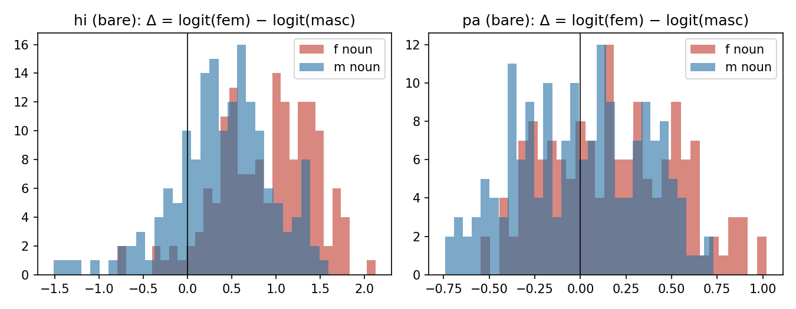

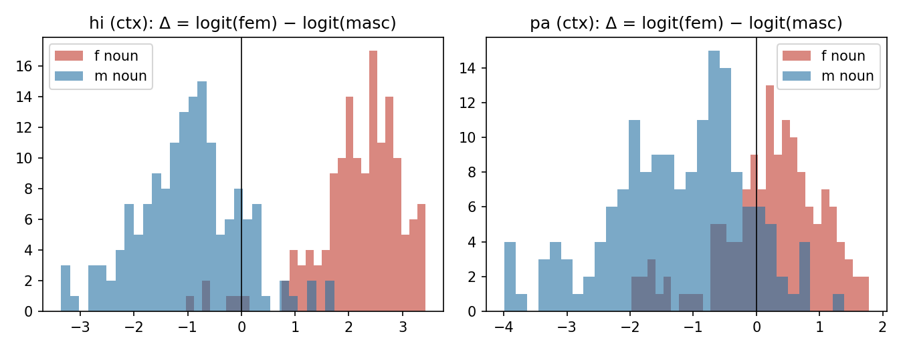

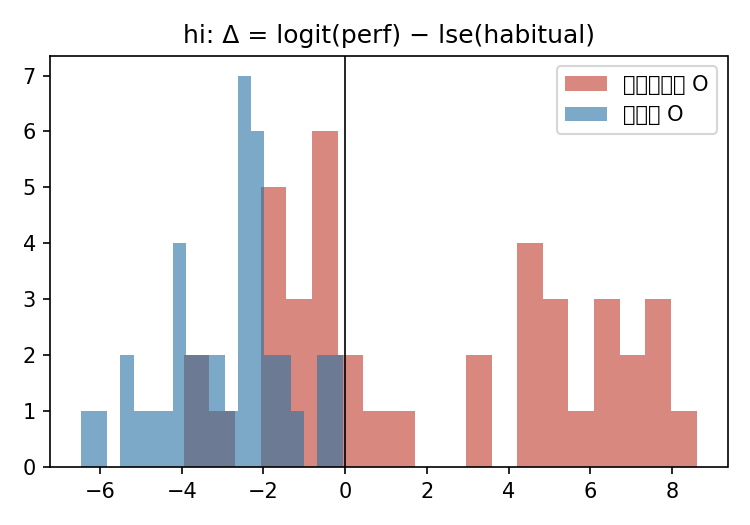

## Stage 1 — logit lens + DLA: c1_hi

- n=304; DLA reconstruction rel. error=1.36e-07
- final lens gap (A−B) = 3.16; first layer where gap > ½ final: 21
- top components (differential DLA): mlp21 +2.42, mlp23 +1.78, mlp22 +1.44, attn21 +0.85, mlp24 +0.44, attn23 -0.25, attn18 +0.12, attn22 +0.08
- top heads (layer, head, diff): L21H4 +0.84, L23H1 -0.26, L24H2 -0.16, L18H6 +0.16, L24H3 +0.13, L25H7 -0.09, L17H1 -0.09, L17H3 +0.07

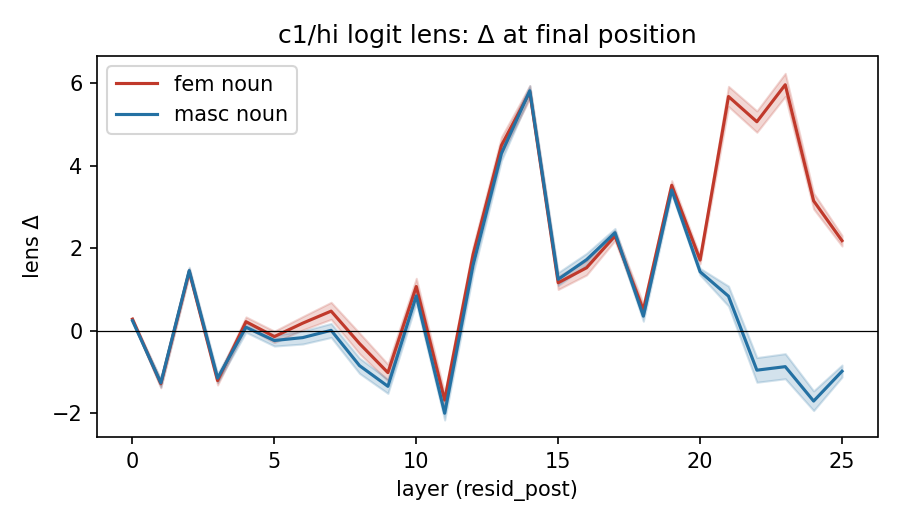

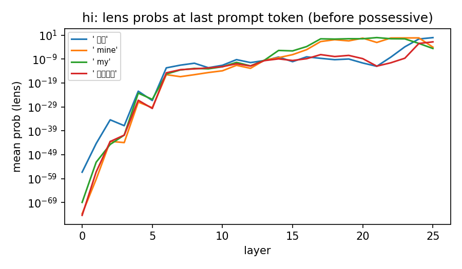

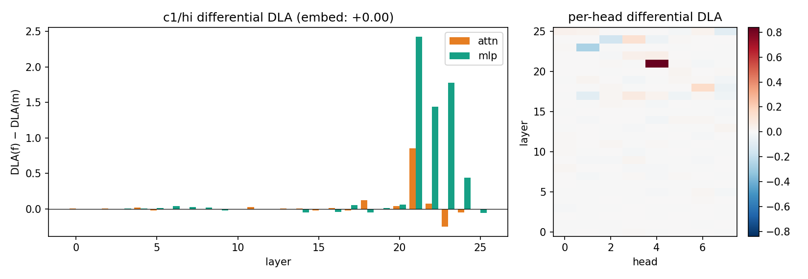

## Stage 1 — logit lens + DLA: c1_pa

- n=304; DLA reconstruction rel. error=1.40e-07
- final lens gap (A−B) = 1.42; first layer where gap > ½ final: 21
- top components (differential DLA): mlp22 +1.18, mlp21 +1.04, mlp23 +0.90, attn21 +0.66, mlp24 +0.21, attn23 -0.16, attn25 -0.09, attn22 +0.08
- top heads (layer, head, diff): L21H4 +0.65, L23H1 -0.16, L25H7 -0.11, L24H2 -0.07, L22H4 +0.05, L24H3 +0.04, L24H4 -0.04, L18H6 +0.04

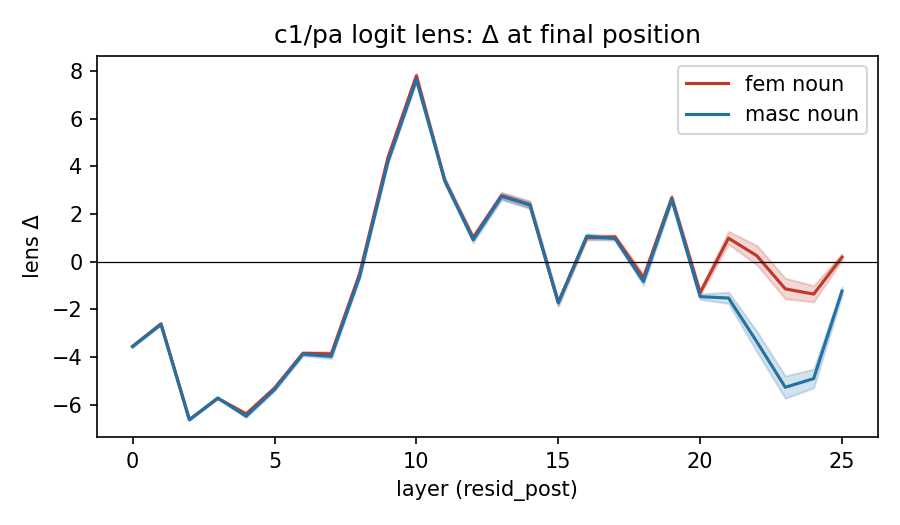

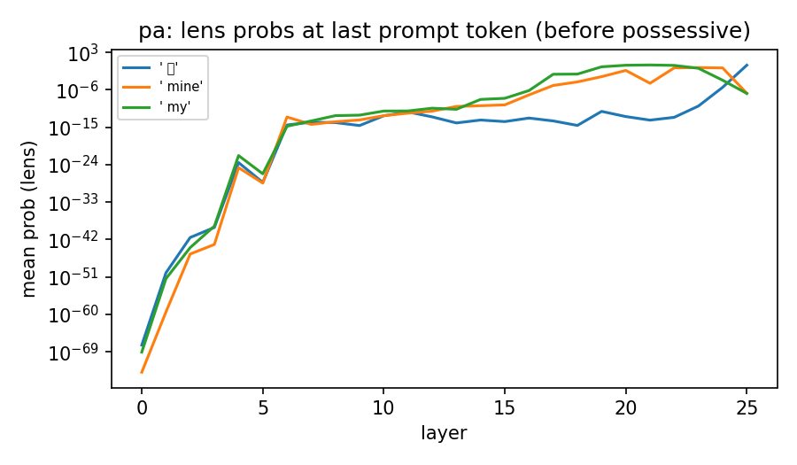

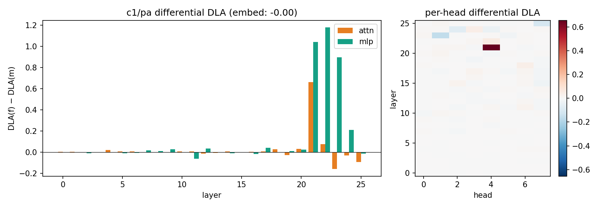

## Stage 1 — logit lens + DLA: c2_hi

- n=80; DLA reconstruction rel. error=1.29e-07
- final lens gap (A−B) = 5.07; first layer where gap > ½ final: 20
- top components (differential DLA): mlp23 +1.62, mlp24 +1.40, mlp22 +1.24, mlp21 +1.05, mlp20 +0.76, attn25 +0.52, mlp25 +0.44, mlp19 +0.35
- top heads (layer, head, diff): L25H7 +0.24, L19H3 +0.21, L23H1 -0.21, L20H1 +0.17, L25H1 +0.15, L24H3 +0.10, L25H0 +0.09, L24H2 -0.09

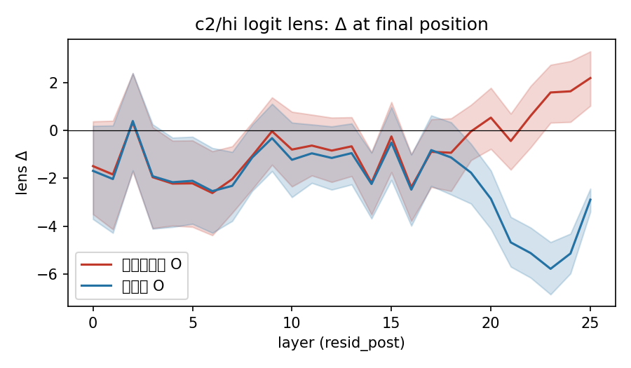

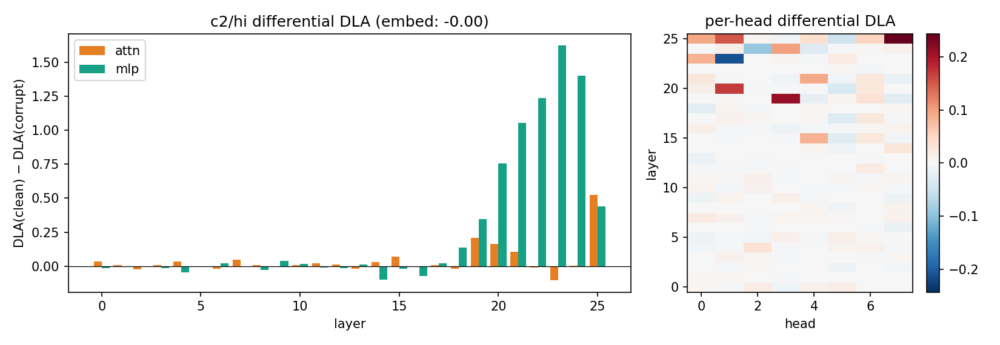

## Stage 2 — activation patching: c1_hi

- pairs used 200 (of 296, 244 correct both ways); Δ_clean 1.770 [1.645, 1.891], Δ_corrupt -1.734 [-1.857, -1.607]
- example: `यह कुर्सी मेरी है। यह कमरा मेरा है। यह कटोरा असल में मे` vs `यह कुर्सी मेरी है। यह कमरा मेरा है। यह चिट्ठी असल में मे`; roles {'w_first': '▁क', 'w_mid': 'ो', 'w_last': 'रा', 'mid_first': '▁अस', 'mid_inner': 'ल', 'mid_last': '▁में', 'END': '▁मे'}
- sanity: full layer-0 patch err 0.0, identity err 0.0

- resid_pre top sites: L7/w R=1.00 [0.98,1.02], L0/w R=1.00 [1.00,1.00], L1/w R=1.00 [1.00,1.00], L23/END R=1.00 [1.00,1.00], L2/w R=1.00 [0.99,1.00], L24/END R=1.00 [1.00,1.00]

- attn_out top sites: L21/END R=0.86 [0.84,0.88], L2/w_last R=0.20 [0.16,0.23], L1/w_last R=0.19 [0.15,0.22], L3/w_last R=0.14 [0.11,0.17], L1/w_mid R=0.12 [0.09,0.15], L16/END R=0.06 [0.06,0.07]

- mlp_out top sites: L21/END R=0.60 [0.59,0.62], L15/w R=0.42 [0.24,0.59], L15/w_last R=0.40 [0.36,0.44], L6/w R=0.35 [0.20,0.49], L19/w_last R=0.35 [0.32,0.37], L2/w_last R=0.34 [0.31,0.38]

- heads top: L21H4/END R=0.86, L1H7/w_last R=0.10, L2H1/w_last R=0.07, L1H7/w_mid R=0.06, L16H3/mid_last R=0.04, L23H1/END R=-0.04, L2H5/w_last R=0.04, L16H3/w R=0.04

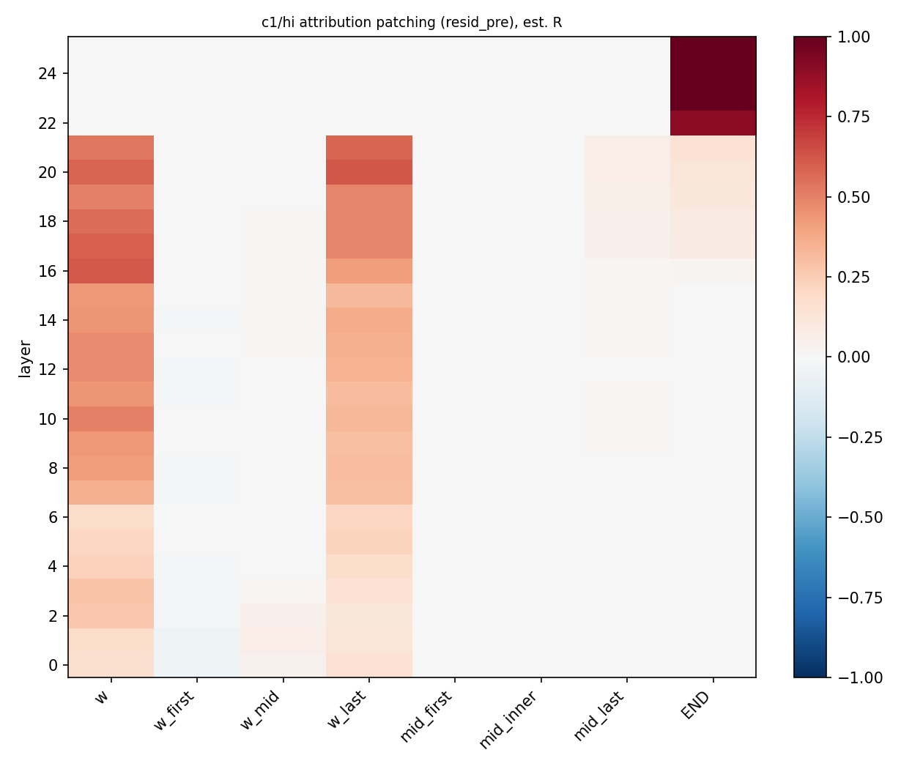

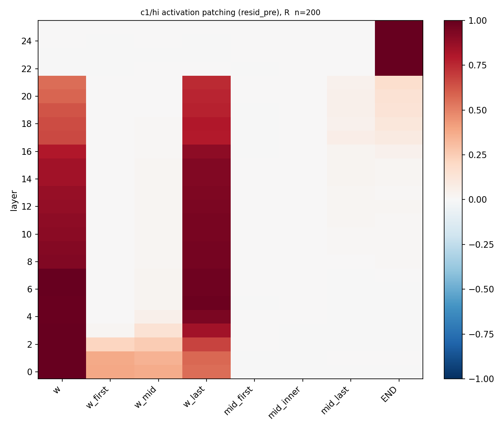

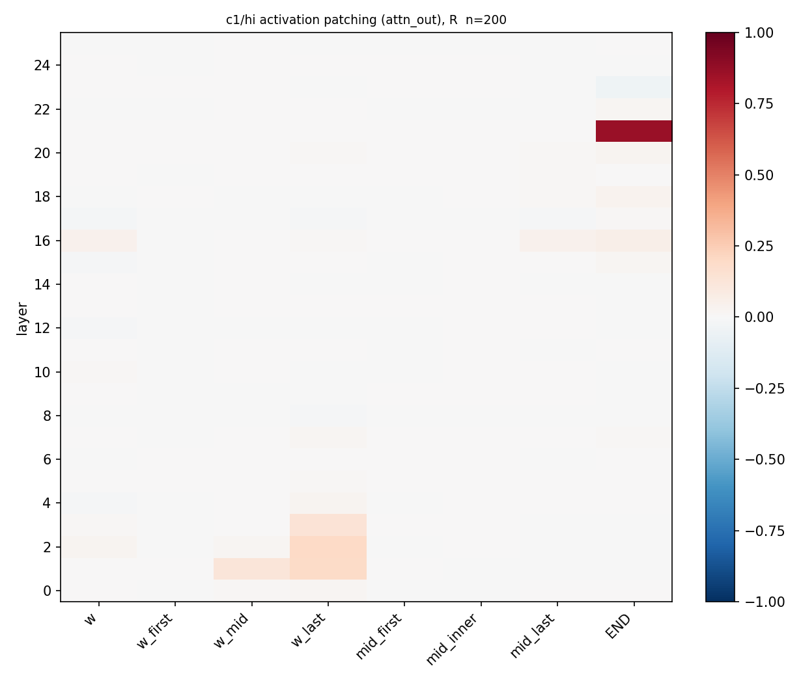

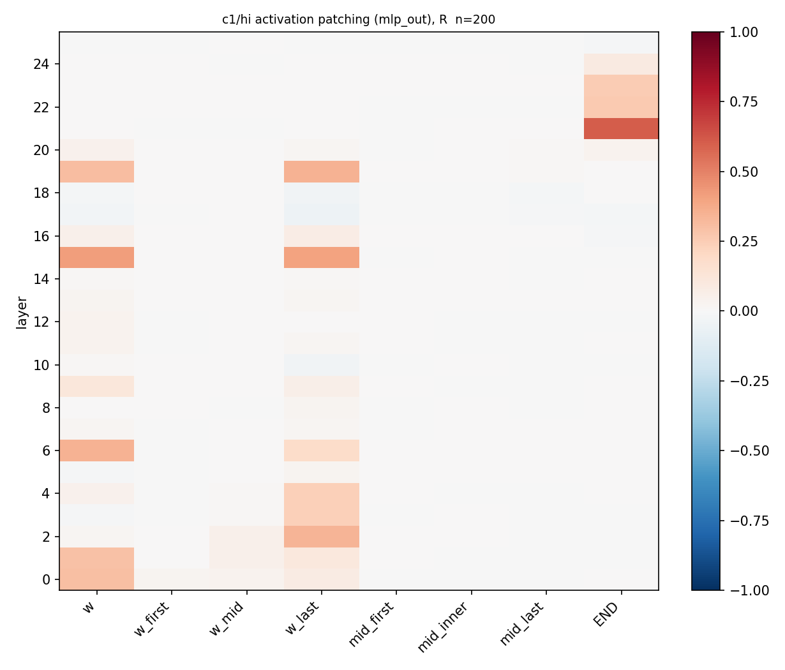

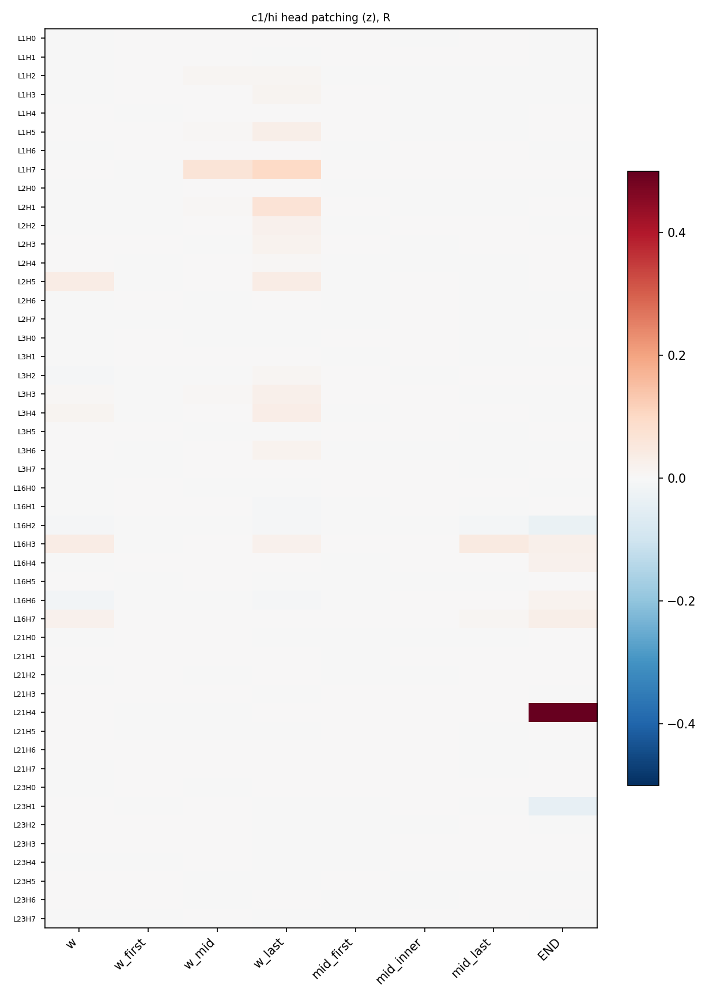

## Stage 2 — activation patching: c1_pa

- pairs used 144 (of 248, 144 correct both ways); Δ_clean 0.934 [0.810, 1.054], Δ_corrupt -0.934 [-1.057, -0.811]
- example: `ਇਹ ਕੁਰਸੀ ਮੇਰੀ ਹੈ। ਇਹ ਕਮਰਾ ਮੇਰਾ ਹੈ। ਇਹ ਦਫ਼ਤਰ ਅਸਲ ਵਿੱਚ ਮੇ` vs `ਇਹ ਕੁਰਸੀ ਮੇਰੀ ਹੈ। ਇਹ ਕਮਰਾ ਮੇਰਾ ਹੈ। ਇਹ ਗੁੱਡੀ ਅਸਲ ਵਿੱਚ ਮੇ`; roles {'w_first': '▁ਦ', 'w_mid': 'ਤ', 'w_last': 'ਰ', 'mid_first': '▁ਅ', 'mid_inner': 'ਲ', 'mid_last': '▁ਵਿੱਚ', 'pfx': '▁ਮ', 'END': 'ੇ'}
- sanity: full layer-0 patch err 0.0, identity err 0.0

- resid_pre top sites: L23/END R=1.00 [1.00,1.00], L22/END R=1.00 [1.00,1.00], L24/END R=1.00 [1.00,1.00], L25/END R=1.00 [1.00,1.00], L6/w_last R=0.89 [0.83,0.94], L7/w_last R=0.89 [0.83,0.94]

- attn_out top sites: L21/END R=0.82 [0.79,0.84], L2/w_last R=0.13 [0.09,0.18], L3/w_last R=0.13 [0.09,0.16], L1/w_last R=0.10 [0.06,0.15], L1/w_mid R=0.09 [0.07,0.11], L16/mid_last R=0.07 [0.06,0.07]

- mlp_out top sites: L21/END R=0.54 [0.53,0.56], L2/w_last R=0.38 [0.33,0.43], L22/END R=0.32 [0.31,0.33], L23/END R=0.27 [0.27,0.28], L15/w_last R=0.26 [0.22,0.30], L19/w_last R=0.22 [0.19,0.25]

- heads top: L21H4/END R=0.81, L1H7/w_last R=0.08, L16H3/mid_last R=0.07, L16H2/END R=-0.05, L23H1/END R=-0.05, L1H7/w_mid R=0.05, L2H1/w_last R=0.04, L2H1/w_mid R=0.03

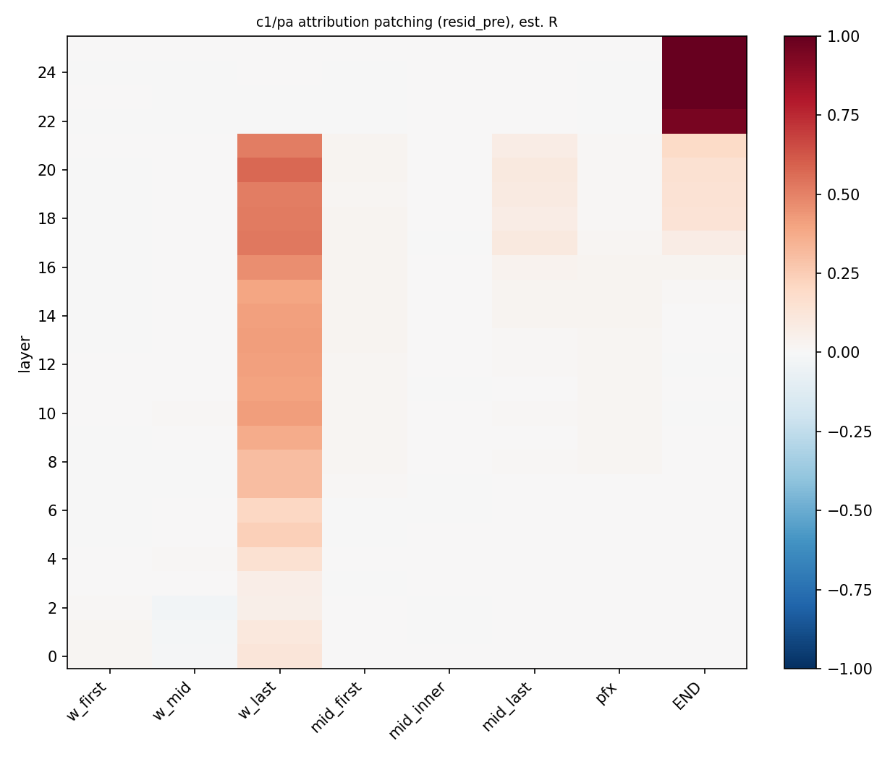

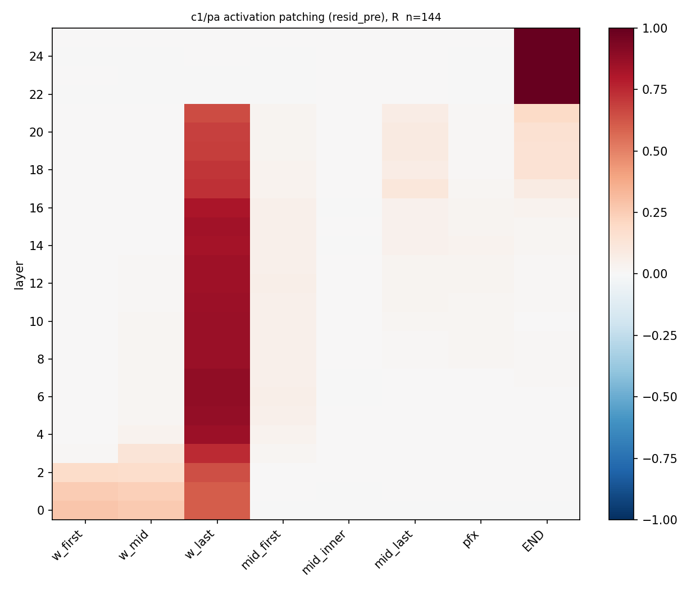

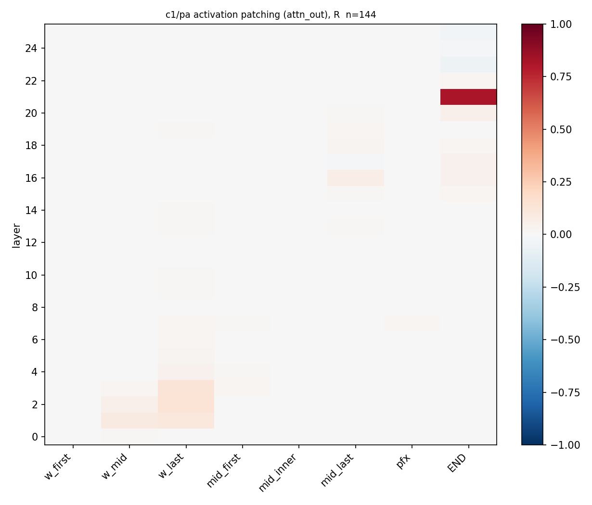

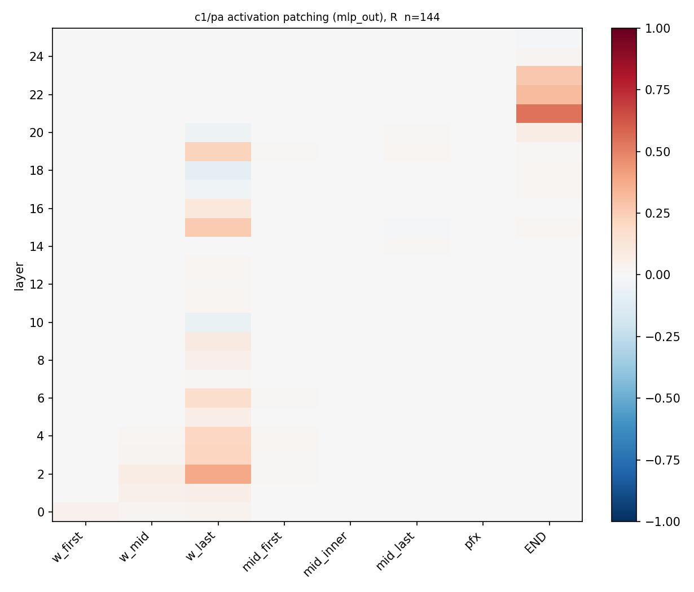

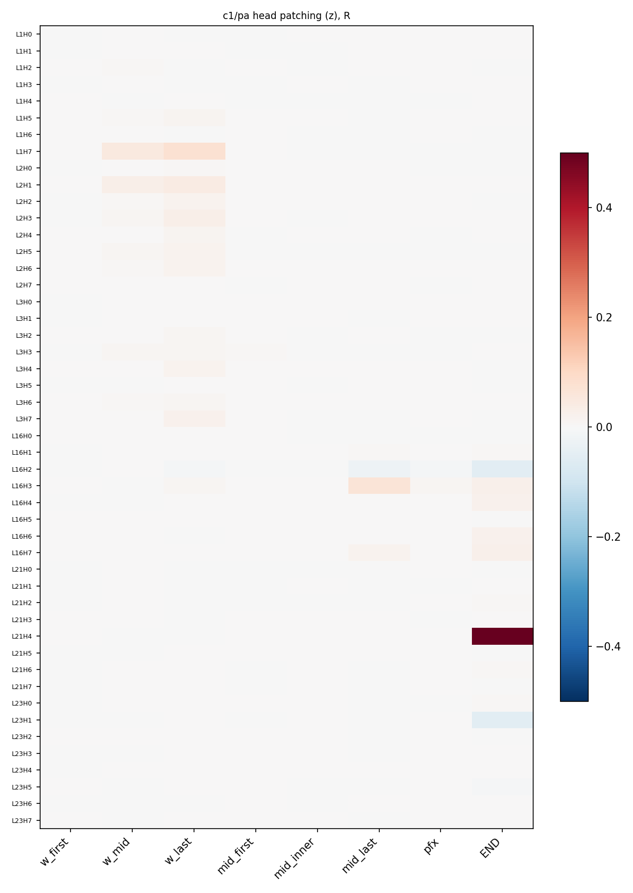

## Stage 2 — activation patching: c2_hi

- pairs used 38 (of 40, 38 correct both ways); Δ_clean 2.311 [1.124, 3.500], Δ_corrupt -3.029 [-3.507, -2.586]
- example: `हाँ, मैंने खाना खा` vs `हाँ, मैं खाना खा`; roles {'w': '▁मैंने', 'mid_first': '▁खा', 'mid_last': 'ना', 'END': '▁खा'}
- sanity: full layer-0 patch err 0.0, identity err 0.0

- resid_pre top sites: L0/w R=1.00 [1.00,1.00], L25/END R=1.00 [0.99,1.00], L24/END R=0.99 [0.99,1.00], L1/w R=0.99 [0.98,1.00], L2/w R=0.99 [0.97,1.00], L23/END R=0.99 [0.98,1.00]

- attn_out top sites: L18/END R=0.21 [0.18,0.24], L20/END R=0.17 [0.16,0.20], L19/END R=0.14 [0.13,0.17], L21/END R=0.10 [0.07,0.14], L25/END R=0.06 [0.05,0.07], L15/END R=0.04 [0.03,0.04]

- mlp_out top sites: L20/END R=0.34 [0.30,0.36], L23/END R=0.28 [0.24,0.32], L21/END R=0.28 [0.24,0.31], L22/END R=0.27 [0.23,0.30], L19/END R=0.23 [0.20,0.25], L24/END R=0.21 [0.18,0.25]

- heads top: L18H0/END R=0.22, L20H1/END R=0.14, L19H3/END R=0.13, L21H4/END R=0.10, L15H4/END R=0.04, L25H1/END R=0.03, L18H0/mid_last R=0.03, L19H6/END R=0.02

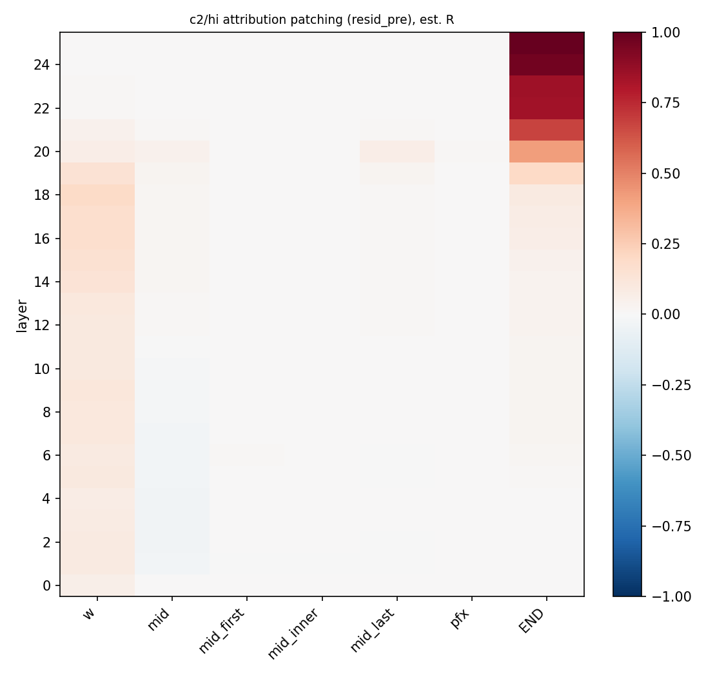

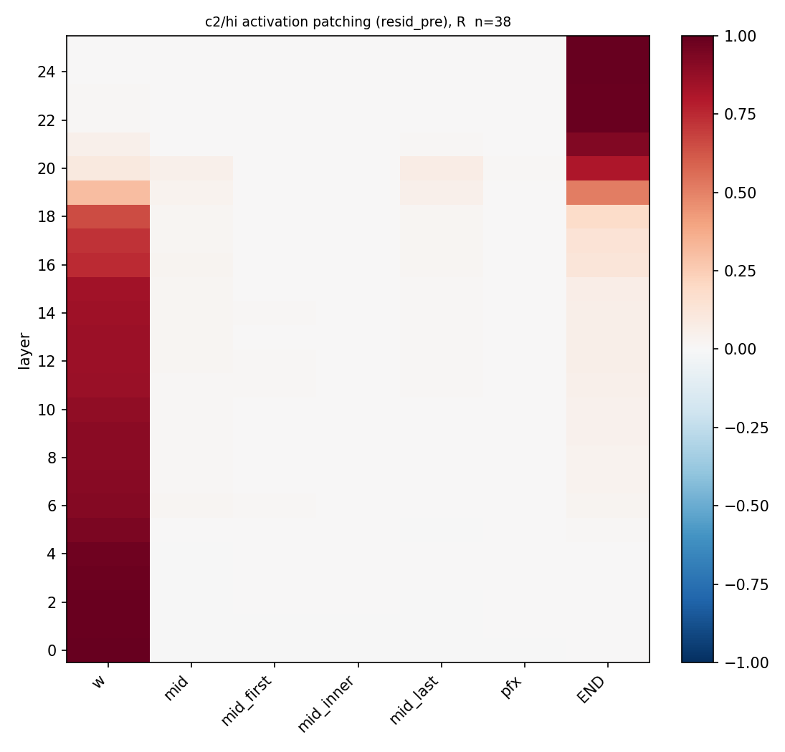

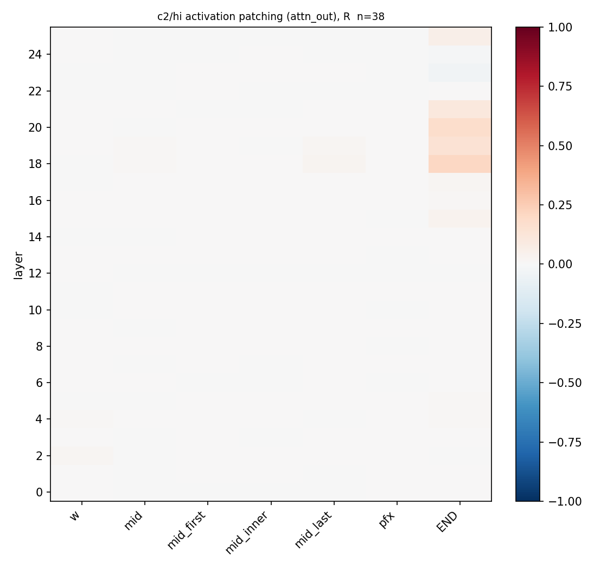

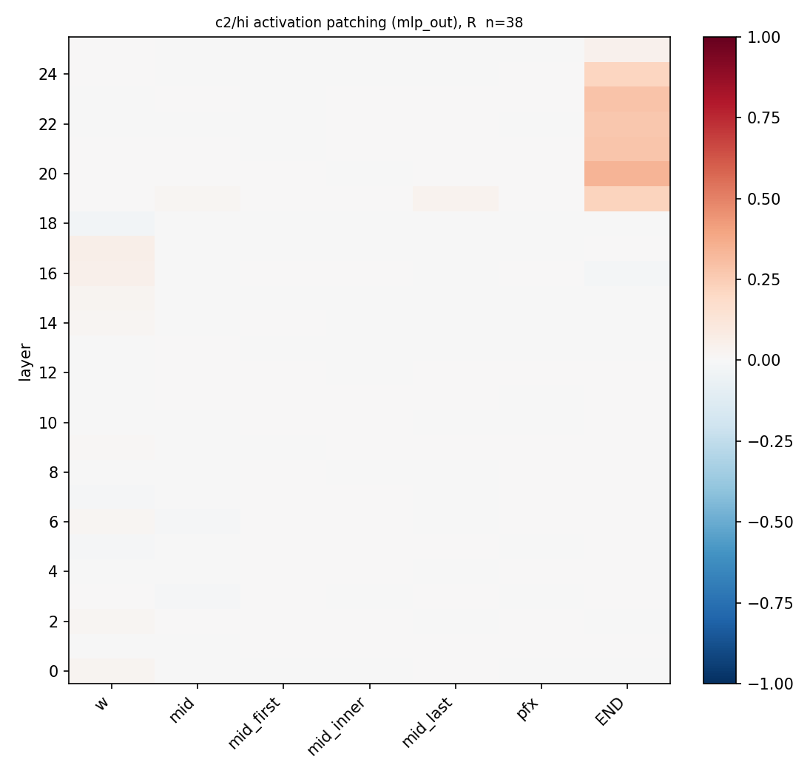

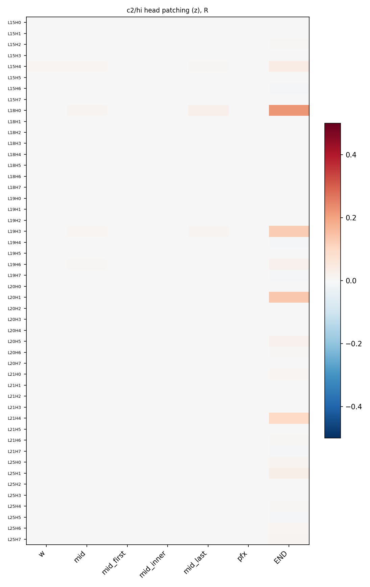

## Stage 3a — noun-gender probes (templates)

- [noun] hi: best selectivity 0.13 at layer 0 (acc 0.92, control 0.80)

- [noun] pa: best selectivity 0.16 at layer 0 (acc 0.87, control 0.71); hi→pa transfer max 0.93 at layer 10 (shuffled 0.58, cos 0.36)

- [noun] en: best selectivity 0.04 at layer 0 (acc 1.00, control 0.96); hi→en transfer max 0.87 at layer 7 (shuffled 0.55, cos 0.30)

- [noun] ta: best selectivity 0.06 at layer 0 (acc 0.75, control 0.69); hi→ta transfer max 0.78 at layer 10 (shuffled 0.41, cos 0.20)

- [final] hi: best selectivity 0.05 at layer 10 (acc 1.00, control 0.95)

- [final] pa: best selectivity 0.03 at layer 19 (acc 1.00, control 0.97); hi→pa transfer max 0.55 at layer 6 (shuffled 0.49, cos 0.16)

- [final] en: best selectivity 0.03 at layer 2 (acc 1.00, control 0.97); hi→en transfer max 0.73 at layer 17 (shuffled 0.50, cos 0.27)

- [final] ta: best selectivity 0.04 at layer 23 (acc 1.00, control 0.96); hi→ta transfer max 0.74 at layer 17 (shuffled 0.52, cos 0.25)

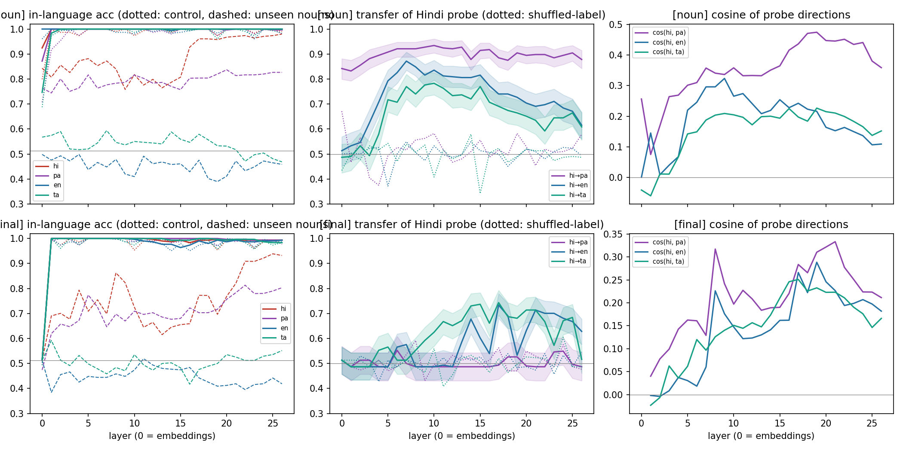

## Stage 3b — treebank case probes

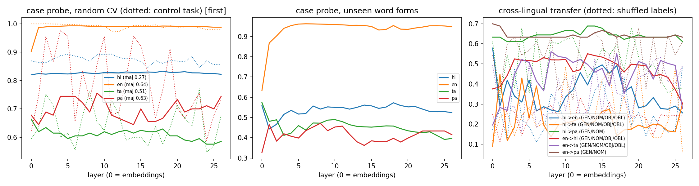

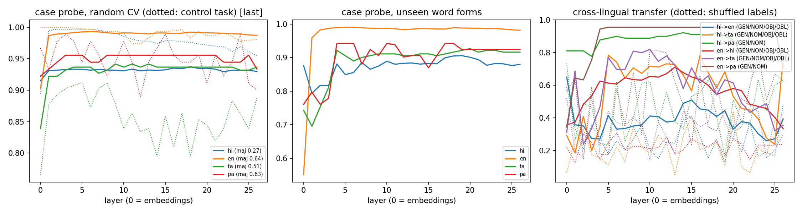

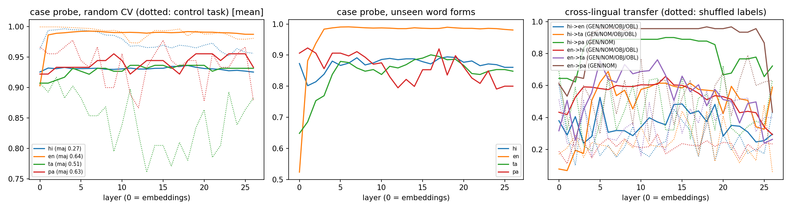

## Stage 4 — SAE features

|   layer | position   | pair             |    corr |   null_mean |   null_95 |   topk_overlap |   gap_before |   gap_after |   frac_gap_removed |   acc_before |   acc_after |
|--------:|:-----------|:-----------------|--------:|------------:|----------:|---------------:|-------------:|------------:|-------------------:|-------------:|------------:|
|       4 | noun       | hi-pa            |   0.276 |       0.007 |     0.076 |              5 |      nan     |     nan     |            nan     |      nan     |     nan     |
|       4 | noun       | hi-en            |   0.144 |      -0.001 |     0.046 |              0 |      nan     |     nan     |            nan     |      nan     |     nan     |
|       4 | noun       | hi-ta            |   0.086 |       0.001 |     0.047 |              0 |      nan     |     nan     |            nan     |      nan     |     nan     |
|       4 | END        | hi-pa            |  -0.005 |      -0     |     0.066 |              1 |      nan     |     nan     |            nan     |      nan     |     nan     |
|       4 | END        | hi-en            |  -0.006 |      -0     |     0.023 |              0 |      nan     |     nan     |            nan     |      nan     |     nan     |
|       4 | END        | hi-ta            |   0.052 |       0.007 |     0.042 |              0 |      nan     |     nan     |            nan     |      nan     |     nan     |
|       4 | END        | steer:top_hi->hi | nan     |     nan     |   nan     |            nan |        3.164 |       3.159 |              0.002 |        0.905 |       0.905 |
|       4 | END        | steer:random->hi | nan     |     nan     |   nan     |            nan |        3.164 |       3.167 |             -0.001 |        0.905 |       0.905 |
|       4 | END        | steer:top_hi->pa | nan     |     nan     |   nan     |            nan |        1.42  |       1.421 |             -0     |        0.78  |       0.78  |
|       4 | END        | steer:random->pa | nan     |     nan     |   nan     |            nan |        1.42  |       1.421 |             -0     |        0.78  |       0.783 |
|       8 | noun       | hi-pa            |   0.362 |      -0.008 |     0.098 |              7 |      nan     |     nan     |            nan     |      nan     |     nan     |
|       8 | noun       | hi-en            |   0.302 |       0.003 |     0.053 |              0 |      nan     |     nan     |            nan     |      nan     |     nan     |
|       8 | noun       | hi-ta            |   0.198 |       0.001 |     0.06  |              0 |      nan     |     nan     |            nan     |      nan     |     nan     |
|       8 | END        | hi-pa            |   0.069 |      -0.001 |     0.068 |              0 |      nan     |     nan     |            nan     |      nan     |     nan     |
|       8 | END        | hi-en            |   0.128 |       0.001 |     0.068 |              0 |      nan     |     nan     |            nan     |      nan     |     nan     |
|       8 | END        | hi-ta            |   0.105 |       0.002 |     0.062 |              0 |      nan     |     nan     |            nan     |      nan     |     nan     |
|       8 | END        | steer:top_hi->hi | nan     |     nan     |   nan     |            nan |        3.164 |       3.146 |              0.006 |        0.905 |       0.905 |
|       8 | END        | steer:random->hi | nan     |     nan     |   nan     |            nan |        3.164 |       3.168 |             -0.001 |        0.905 |       0.905 |
|       8 | END        | steer:top_hi->pa | nan     |     nan     |   nan     |            nan |        1.42  |       1.429 |             -0.006 |        0.78  |       0.783 |
|       8 | END        | steer:random->pa | nan     |     nan     |   nan     |            nan |        1.42  |       1.425 |             -0.003 |        0.78  |       0.783 |
|      12 | noun       | hi-pa            |   0.397 |       0.004 |     0.117 |              6 |      nan     |     nan     |            nan     |      nan     |     nan     |
|      12 | noun       | hi-en            |   0.242 |       0.001 |     0.057 |              0 |      nan     |     nan     |            nan     |      nan     |     nan     |
|      12 | noun       | hi-ta            |   0.233 |       0.01  |     0.067 |              0 |      nan     |     nan     |            nan     |      nan     |     nan     |
|      12 | END        | hi-pa            |   0.171 |       0.011 |     0.146 |              0 |      nan     |     nan     |            nan     |      nan     |     nan     |
|      12 | END        | hi-en            |   0.102 |      -0.004 |     0.036 |              0 |      nan     |     nan     |            nan     |      nan     |     nan     |
|      12 | END        | hi-ta            |   0.102 |       0.002 |     0.046 |              0 |      nan     |     nan     |            nan     |      nan     |     nan     |
|      12 | END        | steer:top_hi->hi | nan     |     nan     |   nan     |            nan |        3.164 |       3.182 |             -0.005 |        0.905 |       0.905 |
|      12 | END        | steer:random->hi | nan     |     nan     |   nan     |            nan |        3.164 |       3.168 |             -0.001 |        0.905 |       0.905 |
|      12 | END        | steer:top_hi->pa | nan     |     nan     |   nan     |            nan |        1.42  |       1.425 |             -0.004 |        0.78  |       0.783 |
|      12 | END        | steer:random->pa | nan     |     nan     |   nan     |            nan |        1.42  |       1.419 |              0.001 |        0.78  |       0.78  |
|      16 | noun       | hi-pa            |   0.483 |      -0.006 |     0.095 |              5 |      nan     |     nan     |            nan     |      nan     |     nan     |
|      16 | noun       | hi-en            |   0.245 |      -0.006 |     0.051 |              0 |      nan     |     nan     |            nan     |      nan     |     nan     |
|      16 | noun       | hi-ta            |   0.249 |       0.007 |     0.086 |              1 |      nan     |     nan     |            nan     |      nan     |     nan     |
|      16 | END        | hi-pa            |   0.177 |      -0.029 |     0.111 |              1 |      nan     |     nan     |            nan     |      nan     |     nan     |
|      16 | END        | hi-en            |   0.141 |       0.002 |     0.045 |              0 |      nan     |     nan     |            nan     |      nan     |     nan     |
|      16 | END        | hi-ta            |   0.146 |       0.007 |     0.065 |              0 |      nan     |     nan     |            nan     |      nan     |     nan     |
|      16 | END        | steer:top_hi->hi | nan     |     nan     |   nan     |            nan |        3.164 |       3.173 |             -0.003 |        0.905 |       0.914 |
|      16 | END        | steer:random->hi | nan     |     nan     |   nan     |            nan |        3.164 |       3.168 |             -0.001 |        0.905 |       0.905 |
|      16 | END        | steer:top_hi->pa | nan     |     nan     |   nan     |            nan |        1.42  |       1.417 |              0.002 |        0.78  |       0.786 |
|      16 | END        | steer:random->pa | nan     |     nan     |   nan     |            nan |        1.42  |       1.406 |              0.01  |        0.78  |       0.783 |
|      18 | noun       | hi-pa            |   0.472 |       0.009 |     0.108 |              4 |      nan     |     nan     |            nan     |      nan     |     nan     |
|      18 | noun       | hi-en            |   0.213 |      -0.009 |     0.058 |              0 |      nan     |     nan     |            nan     |      nan     |     nan     |
|      18 | noun       | hi-ta            |   0.243 |      -0.006 |     0.065 |              0 |      nan     |     nan     |            nan     |      nan     |     nan     |
|      18 | END        | hi-pa            |   0.227 |      -0.006 |     0.167 |              0 |      nan     |     nan     |            nan     |      nan     |     nan     |
|      18 | END        | hi-en            |   0.1   |       0.004 |     0.047 |              0 |      nan     |     nan     |            nan     |      nan     |     nan     |
|      18 | END        | hi-ta            |   0.137 |      -0.005 |     0.052 |              0 |      nan     |     nan     |            nan     |      nan     |     nan     |
|      18 | END        | steer:top_hi->hi | nan     |     nan     |   nan     |            nan |        3.164 |       3.14  |              0.008 |        0.905 |       0.901 |
|      18 | END        | steer:random->hi | nan     |     nan     |   nan     |            nan |        3.164 |       3.138 |              0.008 |        0.905 |       0.908 |
|      18 | END        | steer:top_hi->pa | nan     |     nan     |   nan     |            nan |        1.42  |       1.41  |              0.007 |        0.78  |       0.793 |
|      18 | END        | steer:random->pa | nan     |     nan     |   nan     |            nan |        1.42  |       1.411 |              0.007 |        0.78  |       0.776 |
|      20 | noun       | hi-pa            |   0.477 |       0.012 |     0.152 |              5 |      nan     |     nan     |            nan     |      nan     |     nan     |
|      20 | noun       | hi-en            |   0.161 |      -0.004 |     0.05  |              0 |      nan     |     nan     |            nan     |      nan     |     nan     |
|      20 | noun       | hi-ta            |   0.208 |       0.012 |     0.077 |              1 |      nan     |     nan     |            nan     |      nan     |     nan     |
|      20 | END        | hi-pa            |   0.327 |      -0.002 |     0.258 |              1 |      nan     |     nan     |            nan     |      nan     |     nan     |
|      20 | END        | hi-en            |   0.047 |       0.001 |     0.026 |              0 |      nan     |     nan     |            nan     |      nan     |     nan     |
|      20 | END        | hi-ta            |   0.074 |      -0     |     0.048 |              0 |      nan     |     nan     |            nan     |      nan     |     nan     |
|      20 | END        | steer:top_hi->hi | nan     |     nan     |   nan     |            nan |        3.164 |       2.927 |              0.075 |        0.905 |       0.911 |
|      20 | END        | steer:random->hi | nan     |     nan     |   nan     |            nan |        3.164 |       3.141 |              0.007 |        0.905 |       0.908 |
|      20 | END        | steer:top_hi->pa | nan     |     nan     |   nan     |            nan |        1.42  |       1.429 |             -0.006 |        0.78  |       0.783 |
|      20 | END        | steer:random->pa | nan     |     nan     |   nan     |            nan |        1.42  |       1.419 |              0.001 |        0.78  |       0.776 |
|      21 | noun       | hi-pa            |   0.451 |       0.004 |     0.123 |              4 |      nan     |     nan     |            nan     |      nan     |     nan     |
|      21 | noun       | hi-en            |   0.152 |       0     |     0.04  |              0 |      nan     |     nan     |            nan     |      nan     |     nan     |
|      21 | noun       | hi-ta            |   0.216 |      -0.002 |     0.071 |              0 |      nan     |     nan     |            nan     |      nan     |     nan     |
|      21 | END        | hi-pa            |   0.488 |      -0.017 |     0.273 |              3 |      nan     |     nan     |            nan     |      nan     |     nan     |
|      21 | END        | hi-en            |   0.026 |      -0.004 |     0.036 |              0 |      nan     |     nan     |            nan     |      nan     |     nan     |
|      21 | END        | hi-ta            |   0.03  |       0.001 |     0.037 |              0 |      nan     |     nan     |            nan     |      nan     |     nan     |
|      21 | END        | steer:top_hi->hi | nan     |     nan     |   nan     |            nan |        3.164 |      -2.383 |              1.753 |        0.905 |       0.059 |
|      21 | END        | steer:random->hi | nan     |     nan     |   nan     |            nan |        3.164 |       3.097 |              0.021 |        0.905 |       0.901 |
|      21 | END        | steer:top_hi->pa | nan     |     nan     |   nan     |            nan |        1.42  |      -0.671 |              1.472 |        0.78  |       0.312 |
|      21 | END        | steer:random->pa | nan     |     nan     |   nan     |            nan |        1.42  |       1.423 |             -0.002 |        0.78  |       0.78  |
|      22 | noun       | hi-pa            |   0.427 |      -0.003 |     0.105 |              4 |      nan     |     nan     |            nan     |      nan     |     nan     |
|      22 | noun       | hi-en            |   0.161 |      -0.005 |     0.038 |              0 |      nan     |     nan     |            nan     |      nan     |     nan     |
|      22 | noun       | hi-ta            |   0.226 |       0.019 |     0.094 |              0 |      nan     |     nan     |            nan     |      nan     |     nan     |
|      22 | END        | hi-pa            |   0.604 |      -0.01  |     0.29  |              6 |      nan     |     nan     |            nan     |      nan     |     nan     |
|      22 | END        | hi-en            |   0.039 |      -0.005 |     0.038 |              0 |      nan     |     nan     |            nan     |      nan     |     nan     |
|      22 | END        | hi-ta            |   0.027 |       0.003 |     0.022 |              0 |      nan     |     nan     |            nan     |      nan     |     nan     |
|      22 | END        | steer:top_hi->hi | nan     |     nan     |   nan     |            nan |        3.164 |      -1.075 |              1.34  |        0.905 |       0.332 |
|      22 | END        | steer:random->hi | nan     |     nan     |   nan     |            nan |        3.164 |       3.211 |             -0.015 |        0.905 |       0.914 |
|      22 | END        | steer:top_hi->pa | nan     |     nan     |   nan     |            nan |        1.42  |      -0.341 |              1.24  |        0.78  |       0.359 |
|      22 | END        | steer:random->pa | nan     |     nan     |   nan     |            nan |        1.42  |       1.418 |              0.002 |        0.78  |       0.78  |
|      23 | noun       | hi-pa            |   0.411 |      -0.007 |     0.143 |              2 |      nan     |     nan     |            nan     |      nan     |     nan     |
|      23 | noun       | hi-en            |   0.136 |       0.003 |     0.051 |              0 |      nan     |     nan     |            nan     |      nan     |     nan     |
|      23 | noun       | hi-ta            |   0.239 |      -0.008 |     0.087 |              1 |      nan     |     nan     |            nan     |      nan     |     nan     |
|      23 | END        | hi-pa            |   0.474 |      -0.033 |     0.222 |              5 |      nan     |     nan     |            nan     |      nan     |     nan     |
|      23 | END        | hi-en            |   0.018 |       0     |     0.02  |              0 |      nan     |     nan     |            nan     |      nan     |     nan     |
|      23 | END        | hi-ta            |  -0.015 |       0.002 |     0.024 |              0 |      nan     |     nan     |            nan     |      nan     |     nan     |
|      23 | END        | steer:top_hi->hi | nan     |     nan     |   nan     |            nan |        3.164 |       0.93  |              0.706 |        0.905 |       0.632 |
|      23 | END        | steer:random->hi | nan     |     nan     |   nan     |            nan |        3.164 |       3.135 |              0.009 |        0.905 |       0.901 |
|      23 | END        | steer:top_hi->pa | nan     |     nan     |   nan     |            nan |        1.42  |       0.594 |              0.582 |        0.78  |       0.635 |
|      23 | END        | steer:random->pa | nan     |     nan     |   nan     |            nan |        1.42  |       1.419 |              0.001 |        0.78  |       0.786 |
|      24 | noun       | hi-pa            |   0.412 |      -0.006 |     0.11  |              2 |      nan     |     nan     |            nan     |      nan     |     nan     |
|      24 | noun       | hi-en            |   0.113 |      -0.004 |     0.029 |              0 |      nan     |     nan     |            nan     |      nan     |     nan     |
|      24 | noun       | hi-ta            |   0.177 |       0.003 |     0.104 |              0 |      nan     |     nan     |            nan     |      nan     |     nan     |
|      24 | END        | hi-pa            |   0.547 |       0.011 |     0.29  |              3 |      nan     |     nan     |            nan     |      nan     |     nan     |
|      24 | END        | hi-en            |   0.007 |      -0     |     0.016 |              0 |      nan     |     nan     |            nan     |      nan     |     nan     |
|      24 | END        | hi-ta            |   0.003 |      -0.004 |     0.031 |              0 |      nan     |     nan     |            nan     |      nan     |     nan     |
|      24 | END        | steer:top_hi->hi | nan     |     nan     |   nan     |            nan |        3.164 |       0.962 |              0.696 |        0.905 |       0.651 |
|      24 | END        | steer:random->hi | nan     |     nan     |   nan     |            nan |        3.164 |       3.062 |              0.032 |        0.905 |       0.898 |
|      24 | END        | steer:top_hi->pa | nan     |     nan     |   nan     |            nan |        1.42  |       0.443 |              0.688 |        0.78  |       0.592 |
|      24 | END        | steer:random->pa | nan     |     nan     |   nan     |            nan |        1.42  |       1.426 |             -0.004 |        0.78  |       0.793 |

|   layer |   sae_l0 | position   | lang   |   fve |      l0 |
|--------:|---------:|:-----------|:-------|------:|--------:|
|       4 |       60 | noun       | hi     | 0.805 | 136.875 |
|       4 |       60 | noun       | pa     | 0.748 | 134.77  |
|       4 |       60 | noun       | en     | 0.9   |  81.188 |
|       4 |       60 | noun       | ta     | 0.78  | 139.007 |
|       4 |       60 | END        | hi     | 0.776 | 139.477 |
|       4 |       60 | END        | pa     | 0.747 | 175.355 |
|       4 |       60 | END        | en     | 0.938 |  34.355 |
|       4 |       60 | END        | ta     | 0.814 | 100.079 |
|       8 |       71 | noun       | hi     | 0.868 | 121.684 |
|       8 |       71 | noun       | pa     | 0.847 | 103.783 |
|       8 |       71 | noun       | en     | 0.896 | 101.286 |
|       8 |       71 | noun       | ta     | 0.861 | 115.026 |
|       8 |       71 | END        | hi     | 0.778 | 126.026 |
|       8 |       71 | END        | pa     | 0.796 | 109.651 |
|       8 |       71 | END        | en     | 0.893 |  60.036 |
|       8 |       71 | END        | ta     | 0.811 |  88.908 |
|      12 |       82 | noun       | hi     | 0.812 | 117.247 |
|      12 |       82 | noun       | pa     | 0.789 |  94.533 |
|      12 |       82 | noun       | en     | 0.857 | 111.984 |
|      12 |       82 | noun       | ta     | 0.817 | 105.372 |
|      12 |       82 | END        | hi     | 0.767 | 116.23  |
|      12 |       82 | END        | pa     | 0.746 |  85.832 |
|      12 |       82 | END        | en     | 0.859 |  81.362 |
|      12 |       82 | END        | ta     | 0.821 |  89.625 |
|      16 |       78 | noun       | hi     | 0.822 |  94.382 |
|      16 |       78 | noun       | pa     | 0.802 |  66.395 |
|      16 |       78 | noun       | en     | 0.881 |  91.803 |
|      16 |       78 | noun       | ta     | 0.826 |  81.74  |
|      16 |       78 | END        | hi     | 0.763 |  84.066 |
|      16 |       78 | END        | pa     | 0.759 |  67.954 |
|      16 |       78 | END        | en     | 0.883 |  83.053 |
|      16 |       78 | END        | ta     | 0.813 |  74.539 |
|      18 |       74 | noun       | hi     | 0.844 |  88.155 |
|      18 |       74 | noun       | pa     | 0.834 |  58.128 |
|      18 |       74 | noun       | en     | 0.892 |  84.977 |
|      18 |       74 | noun       | ta     | 0.848 |  74.217 |
|      18 |       74 | END        | hi     | 0.813 |  74.066 |
|      18 |       74 | END        | pa     | 0.791 |  56.845 |
|      18 |       74 | END        | en     | 0.91  |  75.507 |
|      18 |       74 | END        | ta     | 0.859 |  61.043 |
|      20 |       71 | noun       | hi     | 0.841 |  93.891 |
|      20 |       71 | noun       | pa     | 0.834 |  57.625 |
|      20 |       71 | noun       | en     | 0.878 |  89.523 |
|      20 |       71 | noun       | ta     | 0.859 |  72.339 |
|      20 |       71 | END        | hi     | 0.823 |  91.543 |
|      20 |       71 | END        | pa     | 0.801 |  76.191 |
|      20 |       71 | END        | en     | 0.903 |  85.747 |
|      20 |       71 | END        | ta     | 0.882 |  71.5   |
|      21 |       70 | noun       | hi     | 0.847 |  83.747 |
|      21 |       70 | noun       | pa     | 0.846 |  55.842 |
|      21 |       70 | noun       | en     | 0.892 |  84.362 |
|      21 |       70 | noun       | ta     | 0.862 |  70.599 |
|      21 |       70 | END        | hi     | 0.822 |  85.859 |
|      21 |       70 | END        | pa     | 0.788 |  70.385 |
|      21 |       70 | END        | en     | 0.908 |  83.306 |
|      21 |       70 | END        | ta     | 0.868 |  62.138 |
|      22 |       72 | noun       | hi     | 0.83  |  84.77  |
|      22 |       72 | noun       | pa     | 0.827 |  57.875 |
|      22 |       72 | noun       | en     | 0.877 |  75.454 |
|      22 |       72 | noun       | ta     | 0.838 |  79.75  |
|      22 |       72 | END        | hi     | 0.794 |  81.217 |
|      22 |       72 | END        | pa     | 0.753 |  72.319 |
|      22 |       72 | END        | en     | 0.893 |  86.447 |
|      22 |       72 | END        | ta     | 0.852 |  69.546 |
|      23 |       74 | noun       | hi     | 0.827 |  78.188 |
|      23 |       74 | noun       | pa     | 0.822 |  58.171 |
|      23 |       74 | noun       | en     | 0.857 |  79.447 |
|      23 |       74 | noun       | ta     | 0.843 |  68.803 |
|      23 |       74 | END        | hi     | 0.752 |  98.184 |
|      23 |       74 | END        | pa     | 0.731 |  79.589 |
|      23 |       74 | END        | en     | 0.885 |  92.082 |
|      23 |       74 | END        | ta     | 0.859 |  62.753 |
|      24 |       73 | noun       | hi     | 0.869 |  61.553 |
|      24 |       73 | noun       | pa     | 0.837 |  45.079 |
|      24 |       73 | noun       | en     | 0.839 |  72.365 |
|      24 |       73 | noun       | ta     | 0.862 |  48.102 |
|      24 |       73 | END        | hi     | 0.734 |  80.145 |
|      24 |       73 | END        | pa     | 0.68  |  58.434 |
|      24 |       73 | END        | en     | 0.866 |  86.115 |
|      24 |       73 | END        | ta     | 0.889 |  45.97  |

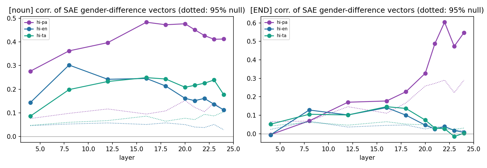
